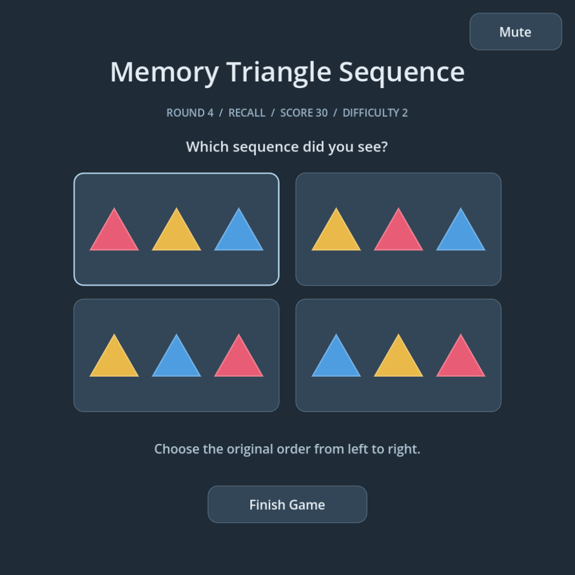

# Memory Triangle Sequence

A visual memory game with triangle sequences and a quick arithmetic challenge, built with **Godot 4** and **GDScript**. Memorize the colors, solve an addition problem, and pick the original sequence.



## Main Features

- Randomized triangle sequences using yellow, blue, and red, drawn directly in Godot.
- Progressive difficulty: start with 2 triangles displayed for 3 seconds. Every 3 consecutive correct recalls adds one triangle and reduces display time by 0.1 seconds, down to a 0.5-second minimum.
- Automatic rounds: the result stays visible for 2 seconds before the next round starts.
- Simple scoring: earn 10 points per correct recall. A mistake resets the success streak while keeping the score and difficulty.
- A persistent **Top 3 High Scores** leaderboard with player names.
- Short synthesized sounds for correct and wrong answers, with **Mute/Unmute** on both screens.
- A resizable interface using Godot's Compatibility renderer.

## Video Demonstration

[Watch Memory Triangle Sequence on YouTube](https://youtu.be/_CsHtGYiDSA)

## Installation and Running

### Requirements

- Godot 4, standard edition. The project has been tested with **Godot 4.7.2**.
- Git to clone the repository, or download and extract the ZIP from GitHub.
- No external assets, plugins, or audio libraries are required.

### Open in the Godot Editor

1. Clone the repository:

   ```sh
   git clone https://github.com/domadordelvent/memory-triangle-sequence.git
   cd memory-triangle-sequence
   ```

2. Open the Godot Project Manager, choose **Import**, and select `project.godot`.
3. Open the imported project and press **F5** to play.

If Godot is available as `godot` on your PATH, you can also open the editor from the project folder:

```sh
godot --path . --editor
```

To run the game directly:

```sh
godot --path .
```

Use the path to your Godot executable if its command has a different name on your system.

## How to Play

1. Click **Start Game** and memorize the triangle sequence from left to right.
2. Answer the addition question. Press **Enter** or click **Check Answer**; incorrect answers can be retried without a penalty.
3. Select the original sequence from four choices.
4. Compare the result with the original sequence. The next round starts automatically after 2 seconds.
5. Click **Finish Game** from either screen to end the session and return to the main screen.

The current difficulty is shown on both game screens. Every 3 consecutive successful recalls raises the difficulty; a failed recall resets only the streak. Longer sequences reuse the same three colors. A new game restores 2 triangles, the initial 3-second display time, and a score of zero.

Use **Mute/Unmute** in the top-right corner to control feedback sounds. Muting stops the current effect immediately and remains in effect across scenes and games during the current launch. Sounds are generated programmatically, and rapid inputs do not stack effects.

## Top 3 High Scores

A qualifying score at **Finish Game** opens a name-entry dialog. Choose **Save Score** to record it or **Skip** to continue without saving. Blank names become `Player`; names are limited to 24 characters. Each game can be submitted only once.

Positive scores qualify while fewer than three entries exist, or when they exceed the current third-place score. The leaderboard is sorted from highest to lowest. Ties keep their submission order, with earlier entries first; a new score tied with third place does not replace an entry on a full board.

Scores persist between launches in this project's `user://high_scores.cfg`. In the editor, use **Project → Open User Data Folder** to find the file. Save failures keep the name dialog open so you can retry.

## Verification

Run from the project folder:

```sh
godot --headless --path . --editor --quit
godot --headless --path . --script tests/prototype.gd
godot --headless --path . --script tests/difficulty.gd
godot --headless --path . --script tests/audio.gd
godot --headless --path . --script tests/high_scores.gd
```

These checks cover gameplay, automatic transitions, duplicate-input protection, difficulty progression and timing limits, feedback playback and muting, responsive layouts, and leaderboard ranking and persistence across a fresh Godot process. Tests avoid overwriting player high scores. Headless audio tests use Godot's dummy driver; run the game normally to hear the effects.

## Project Structure

- `project.godot`: project settings and main scene.
- `triangles.tscn` / `triangles.gd`: memorization, recall, results, and leaderboard interface.
- `math.tscn` / `math.gd`: arithmetic challenge.
- `flow.gd`: shared game state, scoring, difficulty, and round transitions.
- `high_scores.gd`: local leaderboard storage and ranking.
- `feedback_audio.gd` / `mute_button.gd`: synthesized effects and synchronized mute controls.
- `triangle_strip.gd` / `visuals.gd`: triangle drawing and interface theme.
- `tests/`: automated Godot checks.

Godot caches, exported builds, local recordings, and temporary files are excluded from Git. The tracked `.gd.uid` files preserve Godot resource identifiers.

## License

Released under the [MIT License](LICENSE). Copyright (c) 2026 Jordi Prim.
